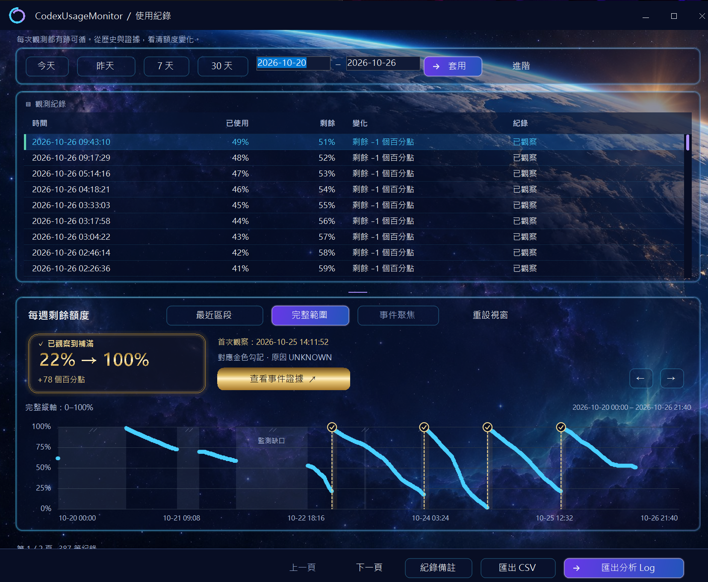

# CodexUsageMonitor｜Codex 額度小幫手

在 Windows 桌面放一個小視窗，看看 **Codex 這週還剩多少額度、用得多快、什麼時候可能重置**。也能保留使用曲線，提醒你留意公開的重置消息。

這是九日自用後分享的**免費、非官方開源工具**，不是 OpenAI 的產品。不會幫你增加額度、兌換券或自動花掉點數。

## 第一次來，從這裡開始

### [⬇ 下載 Windows 試用版 v0.5.0-beta3](https://github.com/hayabusasean/CodexUsageMonitor/releases/download/v0.5.0-beta3/CodexUsageMonitor-v0.5.0-beta3-win-x64.zip)

[下載頁與版本說明](https://github.com/hayabusasean/CodexUsageMonitor/releases/tag/v0.5.0-beta3) · [一步一步教學](docs/START_HERE.md) · [讓自己的 AI 帶你使用](docs/AI_HELP.md) · [費用與資料安全](PRIVACY.md)

**適合誰？** 使用 Windows 64 位元電腦，而且已在電腦安裝支援的官方 Codex、用 ChatGPT 帳號登入的人。只在瀏覽器登入 ChatGPT 還不夠。這份下載不是 Mac、Linux 或 Windows ARM 專用版；不同官方版本、帳號與螢幕配置不保證都適用。

**這是測試版。** v0.5.0-beta3 比 v0.4.1 新，但仍保留測試版標記。GitHub 側邊的 `Latest` 可能指向較舊的正式版；請用上面的明確下載連結。不要下載 `Source code` 或綠色 `Code → Download ZIP`：那是給開發者看的程式碼，不是直接開啟的軟體。

### 下載後怎麼開？

1. 在下載好的 `CodexUsageMonitor-v0.5.0-beta3-win-x64.zip` 上按右鍵，選 **「解壓縮全部」**。
2. 打開解壓縮後的資料夾，雙擊 **`CodexUsageMonitor.exe`**。不需要另裝程式開發工具或 .NET Runtime，也不用以系統管理員身分執行。
3. 工具會嘗試找到電腦上的官方 Codex。正常取得資料後就會顯示額度；預設約每 90 秒更新一次。

**先不要關閉防毒或略過安全警告。** 本工具尚未加上發布者的數位簽章；遇到 Windows 警告、找不到 Codex 或一直沒有數字，先看[新手教學](docs/START_HERE.md)，或把下方這段交給自己的 AI。

### 不懂電腦？複製這段給你的 AI

```text
我想使用這個 Windows 小工具，但不熟 GitHub：
https://github.com/hayabusasean/CodexUsageMonitor
請先閱讀首頁、docs/START_HERE.md、docs/AI_HELP.md 和 PRIVACY.md。
先確認我的電腦是否適用，並說明需要什麼、是否收費、會讀哪些資料。
再用白話帶我找到目前指定的試用版、正確的 ZIP、解壓縮及開啟方式。
先不要替我執行或安裝程式，不要要求 API Key、密碼、登入檔或關閉防毒。
若無法讀取網頁或檢查我的電腦，請直接說明，不要假裝已驗證。
```

[完整 AI 指引：下載前檢查、一步步操作、問題排查](docs/AI_HELP.md)

## 下載前最常問的事

| 問題 | 白話回答 |
| --- | --- |
| 要另外付錢嗎？ | 本工具不收費，也不向 AI 模型提問或購買額度。原本 Codex 的訂閱、點數規則，以及你另外請 AI 幫忙的費用，仍依各自服務而定。 |
| 要填 API Key 嗎？ | **不用。** 請先在官方 Codex 裡用 ChatGPT 帳號登入；本工具不支援只用 API Key 的登入方式。 |
| 會看我的專案或對話嗎？ | 監測功能不讀專案內容、對話、瀏覽器登入資料或直接讀登入檔。它會尋找官方程式、向它查額度，並讀寫本工具自己的設定與歷史。 |
| 會把資料傳給作者嗎？ | 本工具沒有自動回傳使用紀錄的功能。額度查詢仍由官方 Codex 連線；重置消息會讀取部分公開網站，對方能看見一般連線資訊，例如 IP。 |
| 可以保證安全嗎？ | **不能。** 開源、測試通過與檔案校驗都不是安全認證。你可以先交給 AI 或懂程式的人檢查，再決定是否使用。 |

詳細邊界與查核檔案見[費用與資料安全](PRIVACY.md)、[安全問題回報](SECURITY.md)。

## 開啟後，怎麼看？

| 畫面 | 代表什麼 |
| --- | --- |
| 大大的百分比 | **這週剩餘額度**，不是已使用比例。 |
| 使用速度，例如 `2.5%/h` | 大約每小時減少 2.5 個百分點；例如 50% 降到 47.5%。不是金額，也不代表固定能問幾次。 |
| 重置倒數、預計用完時間 | 根據官方回報與已觀察資料估算，不是保證。資料不夠時會顯示不足。 |
| 重置消息或紅點 | 有值得留意的公開消息，**不等於你的帳號已重置**。 |
| 使用紀錄 | 查看工具開著時累積的曲線。關機、休眠或關閉工具期間不會補造紀錄。 |
| 匯出表格／匯出分析報告 | 分別存成表格資料或較詳細的文字報告；不會自動傳給 AI。分享前要先檢查隱私。 |

在浮窗上**按右鍵**可開啟使用紀錄、額度詳情、重置消息、設定。視窗藏起來時，點 Windows 右下角的小圖示；找不到就先點 `∧` 展開。要真正停止記錄，從右鍵選單選 **「離開」**，不只是隱藏視窗。

## 實機畫面

以下四張由作者在 2026-10-23 與 2026-10-26 提供，保留原始數值；是當時版本的實測畫面，最新版本部分按鈕文字已改得更白話。

**真實使用紀錄**：10/20～10/26 的曲線，觀察到 22% → 100%（增加 78 個百分點）。這只證明觀察到回升，不能確認補滿原因。[這張圖片的說明](docs/field-trial/usage-history-2026-10-26.md)



<details>
<summary>再看標準浮窗、精簡浮窗與重置消息</summary>


圖片裡的來源可讀率，只表示當時納入計算的網站可讀，不是重置機率，也不是全網消息完整率。

</details>

## 已經用過舊版？

先在舊版右鍵選單選「離開」，再開新版；不要用覆蓋執行中的程式來升級。原本的歷史資料會留在電腦上，但仍建議升級前自行保留備份。**0.4.1 與新版的設定保存方式不同，退回 0.4.1 前先看[升級與退版](docs/START_HERE.md#升級與退版)。不要刪除歷史或登入資料來排錯。**

## 遇到問題

先看[常見問題](docs/START_HERE.md#遇到問題先看這裡)。仍無法解決，可到 [GitHub 回報](https://github.com/hayabusasean/CodexUsageMonitor/issues)，提供版本、Windows 版本、操作步驟與遮掉私人資訊的截圖。需要摘要時，從「關於 → 複製問題摘要」先預覽再複製；不要公開整包設定、登入檔或完整歷史。

[本次更新與測試範圍](docs/releases/v0.5.0-beta3.md) · [程式碼檢查紀錄](docs/reviews/2026-10-26.md) · [進階說明](docs/ADVANCED.md) · [自行編譯](README_BUILD.md) · [版本紀錄](CHANGELOG.md) · [MIT 授權](LICENSE)

個人維護、盡力處理回報，不承諾即時支援。本專案不隸屬 OpenAI，也未受其背書。
