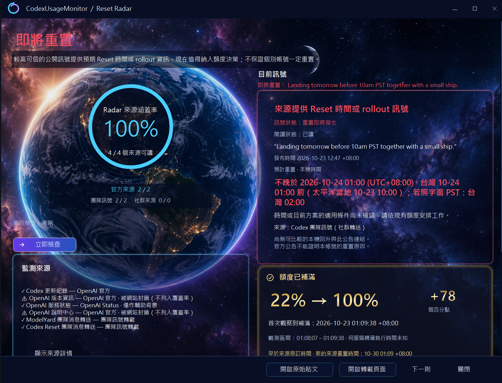

# CodexUsageMonitor 0.5.0-beta2

把每週 Codex 剩餘額度、使用速度與重置倒數放在 Windows 桌面上，並保留本機歷史。

這是九日自用的非官方工具，以 MIT 授權開源。0.5.0-beta2 為預發行試用版；介面、通知與新版說明使用繁體中文。

## 下載與本版重點

[下載 0.5.0-beta2（Windows x64 預發行版）](https://github.com/hayabusasean/CodexUsageMonitor/releases/tag/v0.5.0-beta2) · [發行說明](docs/releases/v0.5.0-beta2.md) · [回報問題](https://github.com/hayabusasean/CodexUsageMonitor/issues)

- 浮窗直接顯示剩餘額度、燒速、重置倒數與預計用完時間；標準與精簡模式都可使用。
- 每週重置與公告重置分別計算預測，主倒數優先顯示較早的期限。
- 改善 Tibo／Reset Radar 分類、回覆串合併與太平洋時區判讀，同時顯示台灣時間。
- 通知區單擊即可叫回浮窗；專屬圖示顯示剩餘百分比。
- 加入重置／券提醒、不含帳號識別資料的 `status.v1.json`，並減少背景與檔案重複處理。
- beta2 補上 `EMAIL_SCOPED` 身分接續、隔離資料目錄與首次背景繪圖診斷。歷史 CSV 契約與唯讀 RPC 邊界保持相容。

## 實機畫面

以下三張是九日於 2026-10-23 提供並授權發布的原始截圖，未修改用量、倒數或訊號內容；數字只代表截圖當時的狀態。

**標準浮窗**：每週剩餘、最近 2 小時燒速、公告重置倒數、預計用完時間與券到期資訊。


**精簡浮窗**：保留剩餘額度、燒速與重置倒數，適合常駐桌面。


**Reset Radar**：公開訊號、本機補額紀錄與來源狀態分別呈現。



畫面中的來源涵蓋率 100% 指目前納入分母的 4 個來源都可讀；被網站封鎖的來源另行標示並移出分母。它不是重置機率，也不代表已讀取所有網路消息。公開公告不保證個別帳號一定重置，本機補額紀錄也不直接證明其原因。

## 開始試用與升級

先安裝並登入官方 Codex，再從 [0.5.0-beta2 預發行頁](https://github.com/hayabusasean/CodexUsageMonitor/releases/tag/v0.5.0-beta2) 下載 `CodexUsageMonitor-v0.5.0-beta2-win-x64.zip`，解壓縮整個資料夾後執行 `CodexUsageMonitor.exe`。使用者不必另外安裝 .NET Runtime。GitHub 自動產生的 Source code 壓縮檔是原始碼，不是可直接執行的工具。

升級前，先從舊版的右鍵選單選「結束」，再啟動新版。同一份資料目錄只允許一個歷史寫入程序；直接再開另一份 EXE 會叫回原本的浮窗。資料仍存於 `%LOCALAPPDATA%\CodexUsageMonitor`，保留此目錄即可接續設定與歷史。

第一次啟動新版前，請在舊版已結束時，另外保存一份 `%LOCALAPPDATA%\CodexUsageMonitor\settings.json`。這份升級前的設定含有舊 `Salt`，請妥善保管，不要上傳或分享。不要假定 `settings.json.pre-bilingual.bak` 一定存在或適合退版；它是早期語言設定遷移的備份，並非 DPAPI 升級備份。

若要退回 0.4.1，先結束新版，再將這份升級前的 `settings.json` 還原到原位置，最後才啟動 0.4.1。新版將原 `Salt` 以 Windows DPAPI 保存在 `SaltProtected`，0.4.1 讀不到這個欄位，直接沿用新版設定可能產生新的身分鍵，使前後歷史無法接續比較。退版只還原設定，既有 `history` 目錄要保留；沒有可用的升級前設定備份時，請保留目前資料並繼續使用新版，先不要直接啟動 0.4.1。DPAPI 資料仍應留在原 Windows 帳戶，不要外傳設定檔。

## 使用獨立資料目錄

不設定 `CODEX_USAGE_MONITOR_HOME` 時，程式沿用 `%LOCALAPPDATA%\CodexUsageMonitor`。需要獨立試用資料時，可在單一 PowerShell 工作階段設定這個環境變數，再啟動同一份正式 EXE，例如：

```powershell
$env:CODEX_USAGE_MONITOR_HOME = 'D:\CodexUsageMonitor-profiles\beta2-review'
& 'D:\放置試用包的位置\CodexUsageMonitor.exe'
```

請將範例中的 EXE 路徑換成實際解壓縮位置。資料目錄必須是一般本機資料夾的絕對路徑，不能是磁碟根目錄、網路路徑或 device 路徑（例如 `\\?\`、`\\.\`）。為避免透過資料夾捷徑寫到其他位置，目標與任何已存在的上層資料夾都不能是 junction、符號連結等重解析點。程式會先將 8.3 短名與 SUBST 磁碟別名解析成實際本機路徑，再拒絕原本的 `%LOCALAPPDATA%\CodexUsageMonitor`、`CODEX_HOME`、這兩者的子資料夾與上層資料夾；解析後是網路路徑也會拒絕。未設定 `CODEX_HOME` 時，保留範圍是使用者目錄下的 `.codex`。同一實際資料夾的別名共用同一把執行鎖。要使用原本的正式資料，請不要設定 `CODEX_USAGE_MONITOR_HOME`。

這個設定只決定本工具的資料位置，不修改 `CODEX_HOME`、系統 `LOCALAPPDATA` 或登入資料。新資料目錄使用正常的 90 秒額度輪詢，不為試跑加速；失敗時仍按原規則退避。關閉這個 PowerShell 工作階段後，其他未設定該變數的啟動方式仍使用原資料目錄。

獨立資料目錄不會建立、修改或刪除 Windows 開機捷徑；設定頁的開機啟動選項停用。即使複製的設定原本啟用開機啟動，也不會套用到全域開機捷徑。

拖曳浮窗可移動位置；右鍵第一項會依狀態切換「顯示浮窗／隱藏浮窗」。隱藏後，單擊右下角工作列通知區的專屬圖示即可叫回；圖示會顯示剩餘百分比。首次隱藏或以隱藏模式啟動時會顯示操作提示。

## 浮窗與預測

| 顯示 | 意義 |
| --- | --- |
| 大百分比 | 每週額度剩餘。 |
| 燒速 | 每小時使用的每週額度百分點，優先採最近 2 小時的估計。 |
| 重置倒數 | 每週重置與有效公告中較早的一個；公告期限會標示為「前」。 |
| 照速度何時用完 | 依目前估計速度推算，不表示程式會自動使用額度。 |
| 重置券 | 可用張數與最早到期時間；詳情依到期日排序。 |
| Radar 圖示 | 公開消息狀態。來源可讀率留在重置資訊頁，不再放在浮窗上。 |

標準與精簡模式都顯示剩餘額度、燒速及重置資訊。「下次查詢還有幾秒」已移到 tooltip。

剩餘 100%，且伺服器回報的重置時間約等於觀察時間加 7 天時，顯示「本週期尚未開始」。第一次使用後才開始計時，因此這段期間不顯示會持續往後滑動的每週倒數。已開始的週期起點由 `reset_at − window_duration_mins` 推回。

燒速只使用同一週期內的連續觀察；重置時間允許正負 120 秒，缺口、來源變更或用量回升會切開區段。每次跳格的時間取前後兩筆採樣的中點，再計算落在視窗內的增加量。`rate_30m` 與 `rate_2h` 的分母使用完整可觀測視窗，包含最後一個跳格後沒有使用的時間；連續觀察不足指定長度時，採實際觀察時長。至少要有兩個不同跳格、累積至少 2 個百分點，才提供速度；否則顯示「資料不足」。`rate_session` 使用本次連續區段的總增加除以區段時長。

例如回放 2026-10-22 23:01 的真實紀錄，最近 2 小時共增加 8 格，`rate_2h` 為 `4.0%/h`。這是本版採用的完整觀察視窗算法。若最後跳格後閒置超過平均跳格間隔的兩倍，另顯示「最近 N 分鐘沒在用」。

每週與公告重置各自計算剩餘時間、重置時預計已用比例、照速度用完的時間，以及期限前用完所需速度。預測只反映已觀察到的使用模式；關機或睡眠期間的用量不補成連續曲線。

## Tibo 與 Reset Radar

RSS 的 `Reset Planned`、`Reset Completed`、`Reset cards` 分別對應 `INCOMING`、`COMPLETED`、`BANKED`，畫面保留這是 relay 分類的說明。同作者 30 分鐘內的回覆可沿用含 reset 的前文，並以 X status ID 還原原始發文時間。

`PST`、`PDT`、`PT` 都按 `America/Los_Angeles` 當地時間與夏令時間解讀，同時顯示台灣時間。例如 `2026-10-22T06:55:54Z` 發出的「Lands tomorrow before 10am PST.」會得到 `2026-10-22T17:00:00Z`，即台灣 10-23 01:00 前，時間品質為 `DEADLINE`。

詞庫可在資料目錄的 `radar_rules.v2.json` 調整。修改後重啟程式套用；檔案格式或規則無效時使用預設規則。出現 `INCOMING` 後，該來源每 5 分鐘查詢一次，直到來源回報完成或本機額度回到 100%。長期回覆 403 的來源會標示「被網站封鎖」，並移出可讀率分母。

兩個網站轉送同一篇貼文，仍是同一則來源說法；公開公告和本機觀察會分別保留。

## 提醒

使用 Windows 通知區的 `ShowBalloonTip`，點通知可開啟詳細資訊。同一帳戶、同一條件在 6 小時內最多提醒一次，重新啟動後仍保留節流紀錄。

1. 公告重置不到 3 小時，且剩餘超過 20%，提醒期限前用完所需速度。
2. 每週重置不到 12 小時，且預計已用不足 90%，提醒仍會剩下多少。
3. 預計在每週重置前用完，且手上有券，提醒券數與最早到期日。
4. 有券在 72 小時內到期，提醒先使用本週額度；若每週重置更早，提醒新週期也要趕在券到期前用完。
5. 公告全球重置即將到來時，提醒先保留券。本機兩次全球重置後券數都沒有減少，因此公告重置前不要急著兌換。

工具只提醒；兌換請自行查看[官方用量頁](https://chatgpt.com/codex/settings/usage)。

## 本機資料與安全

只呼叫 `initialize`、`account/read`、`account/rateLimits/read`、`account/usage/read`。不送 model turn、不兌換券、不購買額度、不直接讀 `auth.json`，也不保存 email 或 token。`account/usage/read` 透過能力偵測使用，不綁特定 Codex 版本。

有 `accountId` 與 `workspaceId` 的來源為 `STABLE_SCOPE`；只有 `accountId` 時為 `ACCOUNT_STABLE`。沒有 `accountId`、但有 email 時，使用既有 HMAC 產生 `EMAIL_SCOPED`，原始 email 僅留在記憶體，不寫入設定、歷史或狀態檔；同一範圍的紀錄可參與分析。真正依每次連線隨機產生的身分才是 `CONNECTION_ONLY`，不跨連線比較。

優先搜尋官方安裝位置，執行 `codex.exe` 前檢查 Authenticode 與 OpenAI 發行者，並記錄驗證過的路徑和 SHA-256；檔案變更後重新驗證。設定中的 HMAC salt 由 Windows DPAPI 以 `CurrentUser` 保護，升級保留原 salt，因此既有歷史身分鍵可接續。

`usage_*.csv` 與 `events_*.csv` 維持 schema 1、原欄位順序、只追加、ID 去重及尾端修復。新分析寫入衍生檔案，不改寫歷史 CSV。資料檔依 UTC 日期分檔；顯示時間以畫面標示的時區為準。

`status.v1.json` 位於資料目錄，提供每週額度、燒速、兩份預測、重置券與繁中建議。時間採 UTC ISO-8601，不含帳號 ID、帳號雜湊或 salt。成功輪詢更新狀態；失敗時寫 `ok:false` 與錯誤碼，保留最後成功數值並標示資料時效。其他程式每 60 秒讀檔即可，工具不另開 HTTP 服務。

JSON 不縮排，內容相同就不重寫；改變時先寫暫存檔再原子替換。Radar 的來源檢查與覆蓋率改為每日追加 JSONL。最近 7 天採樣留在記憶體，Log 記錄狀態轉換與每 30 分鐘心跳，輪替不覆蓋舊檔。背景使用 JPEG 與依尺寸合成的 bitmap 快取，浮窗每秒重畫不再縮放原始大圖。

`diagnostics` 位於目前的資料目錄下，可只提供這個子目錄供問題排查，不必附上設定或歷史 CSV：

- `first_paint_YYYY-MM-DD.jsonl`：日期採 UTC；每個視窗實例首次繪製前後各記一行，共兩行，記錄 DPI、bitmap 尺寸、合成次數與耗時。後續重畫不持續追加。
- `runtime-session_YYYY-MM-DD.jsonl`：記錄啟動時間、實際資料目錄、PID、版本與該 EXE 的 SHA-256。
- `runtime-metrics.v1.json`：記錄實際經過時間、成功輪詢數及寫入量；包含目前這份 EXE 的 SHA-256，可核對試跑與交付檔是否相同。

這些診斷不含 email、accountId、帳戶雜湊、token 或 Salt。視窗實例的隨機 ID、程序 PID 和 EXE 雜湊僅供比對執行與繪圖紀錄；`runtime-session` 會包含本機資料夾路徑，分享前仍可確認路徑是否適合公開。首次繪製診斷不是截圖或錄影，不代表已通過肉眼畫面驗收。

公開來源會看見一般 HTTPS 連線資訊。分享歷史或詳細報告前，請先檢查自己的使用模式與背景資料。本版沒有遙測，也沒有上傳本機歷史。EXE 尚未簽章，請核對發行頁的 SHA-256 清單與來源。

## 驗證與原始碼

本版最終 EXE 的工程驗證為 13 組、395 項：394 通過、1 項 N/A、0 失敗；另完成 12 分鐘真實唯讀隔離監測。三張作者提供的實機截圖見上方；它們證明截圖當時的畫面，不代表已完成所有 DPI、多螢幕、反覆開窗或長時間使用驗收。完整數字與量測範圍見 [beta2 發行說明](docs/releases/v0.5.0-beta2.md)。

[建置與測試](README_BUILD.md) · [版本紀錄](CHANGELOG.md) · [第一次重置的歷史紀錄](docs/stories/first-reset.zh-TW.md) · [MIT 授權](LICENSE)

本專案不隸屬 OpenAI，也未受其背書或贊助。
